 **BỘ NÔNG NGHIỆP VÀ PHÁT TRIỂN NÔNG THÔN**  	 **TRƯỜNG ĐẠI HỌC THUỶ LỢI** 

    	**KHOA CÔNG NGHỆ THÔNG TIN** 

    	**BỘ MÔN HỆ THỐNG THÔNG TIN** 

**BÀI TẬP LỚN** 

**CHUYÊN ĐỀ CÔNG NGHỆ THÔNG TIN**

**Đề tài: Xây dựng ứng dụng xe công nghệ và giao nhận hàng hóa JetPost trên nền tảng di động Flutter**

**Giáo viên hướng dẫn: TS. Hoàng Quốc Dũng**

| STT  | Mã sinh viên  | Họ và tên  | Vai trò & Phân hệ phụ trách |
| :---: | :---: | :---: | :--- |
| 1 | 235106xxxx | [Họ và tên Sinh viên 1] | **Phân hệ 1:** Khách hàng & Dịch vụ Đặt cuốc (`lib/modules/customer/`) |
| 2 | 2351060441 | **Nguyễn Văn Hải** | **Phân hệ 2:** Đối tác Tài xế & Vận chuyển (`lib/modules/driver/`) |
| 3 | 235106xxxx | [Họ và tên Sinh viên 3] | **Phân hệ 3:** User & Hạ tầng Định danh (`lib/modules/user/`) |
| 4 | 235106xxxx | [Họ và tên Sinh viên 4] | **Phân hệ 4:** Quản trị Điều hành & Nền tảng (`lib/modules/admin/`) |

**Hà Nội, tháng 10 năm 2026** 

---

# **MỤC LỤC**
*(Tự động cập nhật theo tiêu đề các chương)*

---

# **DANH MỤC HÌNH ẢNH & SƠ ĐỒ**
* Hình 2.1: Sơ đồ Kiến trúc Hệ thống 1 Project Flutter Hợp nhất 4 Module (Mermaid Graph)
* Hình 2.2: Sơ đồ Trình tự Bàn giao Hàng hóa PoD An toàn Hai Lớp (Mermaid Sequence Diagram)
* Hình 2.3: Biểu đồ Usecase Tổng quát Toàn hệ thống JetPost (Mermaid Flowchart)
* Hình 2.4: Sơ đồ Điều hướng & Cây Widget Ứng dụng (Mermaid Graph)
* Hình 2.5: Lược đồ Thực thể Cơ sở Dữ liệu NoSQL Cloud Firestore (Mermaid ER Diagram)

---

# **TÓM TẮT NỘI DUNG**

Đề tài tập trung nghiên cứu, thiết kế và xây dựng ứng dụng di động **JetPost** – nền tảng tích hợp hai dịch vụ cốt lõi: **Gọi xe ôm công nghệ (Ride-hailing)** và **Giao hàng nhanh nội thành (Express Delivery)**. Dự án được triển khai trên nền tảng **Flutter SDK (ngôn ngữ Dart)** kết hợp hệ sinh thái đám mây **Google Firebase (Cloud Firestore, Authentication, Storage)** và dịch vụ bản đồ mã nguồn mở **OpenStreetMap / OpenRouteService API**.

Điểm sáng tạo và đột phá của đề tài nằm ở giải pháp kiến trúc **"1 Project Flutter duy nhất tích hợp 4 Phân hệ nghiệp vụ độc lập"** (Khách hàng, Tài xế, User hạ tầng và Quản trị viên Admin). Hệ thống giải quyết trọn vẹn các bài toán thực tế của ngành giao vận: định vị GPS chạy ngầm thời gian thực (Foreground Service), cơ chế bàn giao hàng hóa an toàn chuẩn logistics hai lớp **Proof of Delivery (PoD)** kết hợp ảnh chụp và mã OTP 4 số ngẫu nhiên do hệ thống quản lý, trung tâm nhắn tin trực tiếp 1-1 (Direct P2P Chat), bàn cờ radar điều hành toàn thành phố và chiến lược tối ưu hóa 100% tài nguyên miễn phí (Free Tier). Báo cáo chuyên đề trình bày toàn diện từ cơ sở lý luận, phân tích yêu cầu, thiết kế kiến trúc hệ thống, biểu đồ usecase, cây widget đến thiết kế cơ sở dữ liệu và kết quả triển khai thực nghiệm.

---

# **Lời Mở Đầu**

Trong bối cảnh chuyển đổi số và sự bùng nổ của nền kinh tế số (On-demand Economy), các ứng dụng gọi xe và giao nhận hàng hóa trên thiết bị di động như Grab, Shopee, Be hay Ahamove đã trở thành một phần thiết yếu trong nhịp sống đô thị hiện đại. Khách hàng ngày càng kỳ vọng sự tiện lợi, minh bạch về giá cước và khả năng theo dõi lộ trình di chuyển thời gian thực; trong khi đó, đối tác tài xế cần một công cụ làm việc ổn định, nhận cuốc xe thông minh và quy trình xác nhận bàn giao hàng rõ ràng để tránh tranh chấp.

Xuất phát từ nhu cầu thực tiễn đó, nhóm sinh viên lựa chọn thực hiện đề tài: **“Xây dựng ứng dụng xe công nghệ và giao nhận hàng hóa JetPost trên nền tảng di động Flutter”**. Đề tài hướng tới việc giải quyết bài toán vận tải hành khách và luân chuyển bưu kiện trong đô thị thông qua việc mô phỏng hoàn chỉnh quy trình vận hành của các siêu ứng dụng công nghệ hàng đầu hiện nay.

Về mặt kỹ thuật, đề tài giải quyết một thách thức lớn trong tổ chức mã nguồn của nhóm 4 thành viên: Thay vì phát triển thành nhiều ứng dụng rời rạc gây khó khăn trong việc đồng bộ và kiểm thử, nhóm đã nghiên cứu và ứng dụng thành công mô hình **"Single All-in-One Multi-Role Flutter App"**. Toàn bộ hệ thống được xây dựng trong **đúng 1 Project Flutter duy nhất**, phân tách rõ ràng thành 4 module nghiệp vụ tự chủ thông qua cổng vào hợp nhất **UI Entry Point Gate** và bộ chuyển đổi vai trò linh hoạt (**Demo Role Switcher**). Đồng thời, nhóm đã áp dụng triệt để các kỹ thuật tối ưu hóa tài nguyên đám mây (Google Firebase Spark Free Tier, thuật toán Geohash, bộ lọc khoảng cách GPS 15m) để hệ thống vận hành hoàn hảo với chi phí 0 đồng.

Báo cáo chuyên đề là thành quả nghiên cứu, phân tích và lập trình nghiêm túc của toàn thể 4 thành viên trong nhóm dưới sự hướng dẫn tận tình của thầy giáo **TS. Hoàng Quốc Dũng**. Nhóm rất mong nhận được những ý kiến đóng góp quý báu từ các thầy cô giáo trong Bộ môn Hệ thống thông tin để đề tài ngày càng hoàn thiện hơn nữa.

---

# **CHƯƠNG 1: MỞ ĐẦU**

## **1.1. Lý do chọn đề tài**

1. **Tính cấp thiết và thực tiễn của bài toán giao vận đô thị:**
   Sự phát triển mạnh mẽ của thương mại điện tử và nhu cầu đi lại linh hoạt tại các đô thị lớn tại Việt Nam đòi hỏi các giải pháp kết nối cung – cầu vận tải tức thời. Dịch vụ đặt xe ôm và giao hàng nhanh có sự giao thoa rất lớn về hạ tầng công nghệ: đều cần xác định tọa độ GPS, vẽ tuyến đường tối ưu, tìm kiếm tài xế lân cận theo thuật toán không gian và giám sát hành trình trực tiếp trên bản đồ. Việc tích hợp cả hai dịch vụ trên cùng một nền tảng giúp tối ưu hóa công suất hoạt động của tài xế và mang lại sự tiện nghi cao nhất cho khách hàng.

2. **Yêu cầu về quy trình vận hành chuẩn mực và an toàn (Proof of Delivery - PoD):**
   Trong các hệ thống giao hàng truyền thống, tình trạng thất lạc bưu phẩm, tài xế tự ý xác nhận hoàn thành đơn khi chưa giao hoặc khiếu nại giữa các bên diễn ra thường xuyên. Đề tài tiếp cận các tiêu chuẩn vận hành tiên tiến của các tập đoàn logistics hiện đại bằng cách tích hợp **Quy trình đối soát bàn giao hai lớp**: bắt buộc tài xế phải chụp ảnh gói hàng tại địa chỉ giao kết hợp mã xác thực **OTP 4 số** do hệ thống tự động sinh và gửi độc quyền cho người nhận.

3. **Môi trường ứng dụng và rèn luyện kỹ năng kỹ thuật chuyên sâu:**
   Đề tài tạo cơ hội cho nhóm sinh viên vận dụng tổng hợp các kiến thức cốt lõi của ngành Công nghệ thông tin:
   * Lập trình đa nền tảng hiện đại với **Flutter SDK** và ngôn ngữ **Dart**.
   * Thiết kế và khai thác cơ sở dữ liệu phi quan hệ thời gian thực (**Cloud Firestore NoSQL**).
   * Lập trình dịch vụ định vị chạy ngầm (**Android Foreground Service**) và thuật toán mã hóa tọa độ không gian (**Geohash**).
   * Tích hợp các giao diện lập trình ứng dụng mở (**OpenStreetMap, OpenRouteService API**).
   * Rèn luyện kỹ năng quản lý dự án phần mềm theo nhóm, kiểm soát phiên bản Git và phòng ngừa xung đột mã nguồn.

---

## **1.2. Mục tiêu chính**

### *1.2.1. Các mục tiêu cụ thể*

* **Mục tiêu 1 - Xây dựng Kiến trúc Ứng dụng Hợp nhất Đa vai trò (All-in-One Multi-role App):**
  Xây dựng trọn vẹn hệ thống trong đúng 1 Project Flutter duy nhất, phân tách thành 4 phân hệ module hóa độc lập, đóng gói thành 1 file cài đặt (APK Android) tích hợp cơ chế Cổng vào hợp nhất (UI Entry Point Gate) và công tắc Demo Role Switcher phục vụ kiểm thử và báo cáo trước Hội đồng.

* **Mục tiêu 2 - Phát triển Phân hệ Khách hàng (Customer & Booking Module):**
  Cung cấp giao diện trực quan cho phép khách hàng đặt xe ôm di chuyển và tạo đơn giao hàng nhanh; tính toán giá cước cố định minh bạch (Upfront Pricing); theo dõi xe di chuyển trực tiếp trên bản đồ; quản lý danh bạ địa chỉ quen thuộc và tra cứu lịch sử hoạt động kèm tính năng đặt lại chuyến 1 chạm.

* **Mục tiêu 3 - Phát triển Phân hệ Đối tác Tài xế (Driver Operations Module):**
  Xây dựng công cụ làm việc chuyên nghiệp cho tài xế với công tắc Online/Offline; kích hoạt dịch vụ GPS chạy ngầm (Foreground Service); pop-up tiếp nhận cuốc xe trong bán kính gần; tích hợp deep-link sang Google Maps gốc để dẫn đường giọng nói rảnh tay; thực thi máy trạng thái chuyến đi và quy trình xác nhận bàn giao hàng hóa PoD (chụp ảnh gói hàng + kiểm tra mã OTP).

* **Mục tiêu 4 - Phát triển Phân hệ User & Hạ tầng Định danh (User Module & Shared Infrastructure):**
  Xây dựng động cơ xác thực số điện thoại đa tầng qua Firebase Phone Authentication (OTP 6 số); cơ chế định danh điện tử eKYC chụp ảnh CCCD và bằng lái xe cho tài xế; quản lý hồ sơ cá nhân; phân quyền an ninh RBAC; lưu phiên đăng nhập tự động; và trung tâm nhắn tin trực tiếp 1-1 thời gian thực giữa các người dùng (Direct P2P Chat).

* **Mục tiêu 5 - Phát triển Phân hệ Quản trị Điều hành (Admin Dispatcher & Core Module):**
  Xây dựng bàn cờ Radar toàn cảnh giám sát vị trí toàn bộ đội xe và các đơn hàng thời gian thực; trung tâm thẩm định phê duyệt hồ sơ đối tác tài xế; quản lý người dùng; xử lý khiếu nại tranh chấp đơn hàng; điều chỉnh linh hoạt biểu cước tính tiền; báo cáo thống kê doanh thu; và phát thông báo vận hành khẩn cấp (Broadcast Notifications).

* **Mục tiêu 6 - Tối ưu hóa 100% Tài nguyên Miễn phí (Zero Cost Architecture):**
  Khai thác triệt để gói dịch vụ miễn phí Firebase Spark và API bản đồ mã nguồn mở OpenStreetMap/OpenRouteService kết hợp thuật toán Geohash và bộ lọc khoảng cách di chuyển 15m, đảm bảo hệ thống chạy mượt mà, không phát sinh chi phí duy trì.

---

### *1.2.2. Đối tượng hướng đến*

* **Khách hàng cá nhân:** Người có nhu cầu di chuyển bằng xe máy nhanh chóng trong đô thị hoặc có nhu cầu gửi bưu phẩm, tài liệu, hàng hóa đến người nhận.
* **Người nhận bưu phẩm (Consignee):** Người được gửi hàng, có thể mở app xem lộ trình bưu phẩm đang tới gần và nắm giữ mã OTP để nhận hàng an toàn.
* **Đối tác Tài xế:** Những người sở hữu phương tiện xe máy, có giấy phép lái xe hợp lệ, mong muốn tham gia mạng lưới vận chuyển linh hoạt để tạo thu nhập.
* **Quản trị viên Hệ thống (Admin):** Đội ngũ điều hành, giám sát radar toàn thành phố, thẩm định hồ sơ pháp lý tài xế, quản lý biểu cước và xử lý tranh chấp giao dịch.

---

### *1.2.3. Phạm vi và giới hạn đề tài*

* **Phạm vi nghiên cứu và triển khai:**
  * Ứng dụng di động được xây dựng và đóng gói hoàn chỉnh cho hệ điều hành **Android** (tương thích từ Android 8.0 đến Android 14+). Đồng thời có khả năng biên dịch sang **Flutter Web** phục vụ màn hình điều hành Quản trị viên Admin.
  * Địa bàn hoạt động thử nghiệm tập trung tại khu vực TP. Hà Nội (trọng tâm là khu vực quận Đống Đa quanh Trường Đại học Thủy Lợi).
  * Quy trình vận hành khép kín thời gian thực giữa 4 vai trò thông qua mạng Internet (Wi-Fi / 4G).

* **Giới hạn của đề tài:**
  * Về thanh toán: Hệ thống tập trung hoàn thiện mô hình thanh toán tiền mặt trực tiếp kết hợp đối soát hóa đơn điện tử; chưa tích hợp cổng thanh toán trực tuyến của các ngân hàng thương mại do yêu cầu pháp nhân doanh nghiệp.
  * Về thuật toán điều phối: Áp dụng thuật toán Geohash tìm kiếm tài xế lân cận theo bán kính cố định, chưa áp dụng mô hình máy học (Machine Learning) dự báo nhu cầu hoặc thuật toán nhân giá cước linh hoạt (Dynamic Surge Pricing) phức tạp.

---

## **1.3. Kết quả dự kiến của 4 Phân hệ**

Dự án hướng tới xây dựng một ứng dụng Flutter hợp nhất hoàn chỉnh phục vụ bài toán gọi xe và giao vận tức thì. Kết quả chuyển giao kỹ thuật của 4 phân hệ được tóm lược như sau (chi tiết các luồng chức năng và đặc tả nghiệp vụ được phân tích chuyên sâu tại Chương 2):

### *1.3.1. Phân hệ 1: Module Khách hàng (Customer Module)*
* **Ứng dụng đặt xe & giao hàng Upfront:** Hoàn thiện giao diện đặt xe ôm công nghệ và tạo đơn giao hàng nhanh với cơ chế tính cước cố định (Upfront Pricing) trên bản đồ OpenStreetMap.
* **Theo dõi hành trình thời gian thực (Live Tracking):** Lắng nghe trực tiếp vị trí GPS tài xế từ Firestore, xoay góc xe máy theo hướng di chuyển và ước tính thời gian đến (ETA).
* **Quản trị tiện ích người dùng:** Hỗ trợ tra cứu đơn nhận bưu phẩm tự động lấy mã OTP 4 số, quản lý địa chỉ quen thuộc (Nhà/Cơ quan), xem lại lịch sử cuốc xe và đặt lại chuyến cũ 1 chạm (Re-order).

---

### *1.3.2. Phân hệ 2: Module Đối tác Tài xế (Driver Module)*
* **Dịch vụ GPS ngầm (Foreground Service):** Duy trì phát tọa độ GPS lên hệ thống ngay cả khi tắt màn hình hoặc chuyển ứng dụng, đảm bảo khả năng sẵn sàng nhận cuốc trong bán kính phục vụ.
* **Tiếp nhận & Dẫn đường thông minh:** Cơ chế nhận cuốc lân cận với đồng hồ đếm ngược 15s kết hợp deep-link mở trực tiếp Google Maps để dẫn đường rảnh tay bằng giọng nói tiếng Việt.
* **Quy trình bàn giao an toàn PoD & Ví thu nhập:** Xác thực giao hàng 2 lớp (chụp ảnh hiện trường PoD + nhập mã OTP người nhận), ẩn danh số điện thoại khách hàng và quản lý doanh thu, chiết khấu hoa hồng minh bạch.

---

### *1.3.3. Phân hệ 3: Module User & Hạ tầng Định danh (User Module)*
* **Cổng vào hợp nhất (Welcome Gate) & Phân quyền RBAC:** Cổng điều phối 4 vai trò tích hợp công cụ chuyển vai trò thử nghiệm (Demo Role Switcher) và tự động duy trì phiên đăng nhập an toàn.
* **Động cơ xác thực OTP & eKYC tài xế:** Xác thực số điện thoại đa tầng qua Firebase Phone Auth (SMS OTP) và quy trình chụp ảnh định danh pháp lý (CCCD, GPLX) cho tài xế mới.
* **Hạ tầng tiện ích chung & Nhắn tin P2P:** Cung cấp chức năng quản lý hồ sơ, tùy biến giao diện Sáng/Tối (Dark Mode) và hệ thống nhắn tin trực tiếp 1-1 thời gian thực giữa 2 người dùng bất kỳ.

---

### *1.3.4. Phân hệ 4: Module Quản trị Điều hành (Admin Module)*
* **Bàn cờ Radar giám sát toàn thành phố:** Giám sát trực quan mật độ tài xế trực tuyến và các cuốc xe đang tìm xe theo thời gian thực trên bản đồ số.
* **Trung tâm thẩm định eKYC & Xử lý tranh chấp:** Kiểm tra giấy tờ để phê duyệt/từ chối tài xế mới và đối soát chứng từ số (ảnh PoD, GPS, thời gian nhập OTP) khi phát sinh khiếu nại.
* **Quản lý vận hành & Báo cáo Analytics:** Quản lý tài khoản (khóa/mở), điều chỉnh biểu cước giá/km và chiết khấu hoa hồng tức thì, biểu đồ thống kê doanh thu và phát thông báo Broadcast toàn mạng lưới.

---

# **CHƯƠNG 2: PHÂN TÍCH VÀ THIẾT KẾ HỆ THỐNG**

## **2.1. Công nghệ sử dụng**

### *2.1.1. Công nghệ phát triển ứng dụng (Frontend)*

#### ***A. Khung phần mềm Flutter (Flutter SDK) & Ngôn ngữ Dart***
* **Tổng quan:** Flutter là bộ công cụ phát triển giao diện người dùng (UI Toolkit) mã nguồn mở của Google. Sử dụng ngôn ngữ Dart với cơ chế biên dịch AOT (Ahead-of-Time), Flutter cho phép kết xuất đồ họa trực tiếp ở tốc độ 60 - 120 FPS thông qua công cụ Impeller/Skia mà không cần cầu nối JavaScript Bridge.
* **Vai trò trong dự án:** Xây dựng toàn bộ giao diện và logic của cả 4 phân hệ trong đúng 1 Project duy nhất, đảm bảo tính đồng nhất pixel trên mọi thiết bị Android và Web.
* **Các thư viện cốt lõi:**
  * `geolocator` & `flutter_foreground_task`: Quản trị GPS ngầm và Foreground Service.
  * `flutter_map` & `latlong2`: Hiển thị bản đồ OpenStreetMap mã nguồn mở mượt mà.
  * `image_picker` & `flutter_image_compress`: Xử lý camera chụp ảnh và nén ảnh eKYC/PoD.
  * `shared_preferences`: Lưu trữ token phiên đăng nhập tự động và cấu hình người dùng.
  * `url_launcher`: Kích hoạt deep-link gọi điện thoại và điều hướng Google Maps.

#### ***B. Nền tảng Bản đồ Mở & Định vị Tối ưu Chi phí***
* **OpenStreetMap (OSM) & flutter_map:** Thay vì sử dụng Google Maps API với chi phí đắt đỏ và yêu cầu thẻ tín dụng quốc tế, hệ thống sử dụng OpenStreetMap mã nguồn mở hoàn toàn miễn phí để hiển thị bản đồ nền, vẽ Polyline tuyến đường và hiển thị marker xe máy thời gian thực.
* **OpenRouteService API:** Dịch vụ đám mây cung cấp Geocoding (chuyển đổi địa chỉ chữ thành tọa độ) và thuật toán Dijkstra/A* tính toán khoảng cách quãng đường chính xác theo tuyến giao thông thực tế để chốt giá cước Upfront Pricing.
* **Google Maps App Navigation (Turn-by-turn Deep-link):** Nghiệp vụ chỉ đường rảnh tay cho tài xế được thực hiện bằng cách mở trực tiếp ứng dụng Google Maps gốc có sẵn trên điện thoại tài xế thông qua URL Scheme `google.navigation:q=lat,lng`, tận dụng 100% công nghệ dẫn đường giọng nói tiếng Việt miễn phí.

---

### *2.1.2. Giải pháp Backend và Cơ sở dữ liệu Đám mây (Cloud BaaS)*

#### ***A. Hệ sinh thái Google Firebase Spark (Gói Miễn phí)***
* **Cloud Firestore:** Cơ sở dữ liệu NoSQL lưu trữ hướng tài liệu (Document-oriented). Tính năng vượt trội nhất là cơ chế **Lắng nghe thời gian thực (Real-time Snapshot Streams)**, cho phép mọi thay đổi về vị trí tài xế, trạng thái đơn hàng và tin nhắn chat được đẩy ngay lập tức xuống các máy khách kết nối mà không cần duy trì kết nối WebSocket phức tạp.
* **Firebase Authentication:** Cung cấp dịch vụ xác thực số điện thoại đa tầng qua SMS OTP, kiểm soát phiên đăng nhập an toàn bằng JWT Token và hỗ trợ cấu hình danh sách số điện thoại thử nghiệm (Whitelist Testing Numbers) không tốn phí viễn thông.
* **Cloud Storage:** Lưu trữ an toàn toàn bộ tệp tin đa phương tiện của hệ thống: ảnh chụp CCCD/GPLX phục vụ duyệt hồ sơ tài xế và ảnh chụp bằng chứng giao hàng PoD.
* **Firestore Security Rules:** Tầng bảo vệ an ninh trực tiếp trên đám mây, đảm bảo nguyên tắc phân quyền dữ liệu nghiêm ngặt dựa vào `request.auth.uid` và thuộc tính `role`.

#### ***B. Xử lý Dữ liệu Không gian (Geo-queries) bằng Thuật toán Geohash***
* Để giải quyết bài toán cốt lõi "Tìm kiếm tài xế lân cận trong bán kính X km" mà không cần máy chủ riêng hay Cloud Functions trả phí, hệ thống ứng dụng thuật toán **Geohash**.
* Tọa độ kinh độ/vĩ độ của tài xế được băm thành một chuỗi ký tự (ví dụ: `w4rquv`). Các tài xế ở gần nhau sẽ có chuỗi tiền tố Geohash giống nhau. Nhờ đó, ứng dụng chỉ cần thực hiện truy vấn khoảng chuỗi (Range Query) trên Firestore để lấy danh sách tài xế quanh điểm đón với tốc độ phản hồi tính bằng mili-giây.

---

## **2.2. Kiến trúc Hệ thống Tổng thể**

*Hình 2.1: Sơ đồ Kiến trúc Hệ thống 1 Project Flutter Hợp nhất 4 Module*

```mermaid
graph TD
    APP["1 PROJECT FLUTTER DUY NHẤT: JETPOST"] --> CORE["lib/core/ & lib/models/<br/>(Theme, Constants, Map Service, Firebase Core, CSDL)"]
    APP --> ROUTER["lib/routes/main.dart<br/>(Điểm khởi động ứng dụng & Router Guard bảo mật)"]
    
    ROUTER --> GATE["WelcomeGateScreen<br/>(Màn hình Cổng vào Hợp nhất)"]
    GATE -.-> SWITCHER["Demo Role Switcher Widget<br/>(Chuyển đổi nhanh vai trò kiểm thử)"]
    
    GATE --> MOD1["Module 1: Khách hàng<br/>(lib/modules/customer/)<br/>Thành viên 1"]
    GATE --> MOD2["Module 2: Đối tác Tài xế<br/>(lib/modules/driver/)<br/>Thành viên 2"]
    GATE --> MOD3["Module 3: User & Định danh<br/>(lib/modules/user/)<br/>Thành viên 3"]
    GATE --> MOD4["Module 4: Quản trị Admin<br/>(lib/modules/admin/)<br/>Thành viên 4"]
```

*Hình 2.2: Sơ đồ Trình tự Bàn giao Hàng hóa PoD An toàn Hai Lớp (Proof of Delivery)*

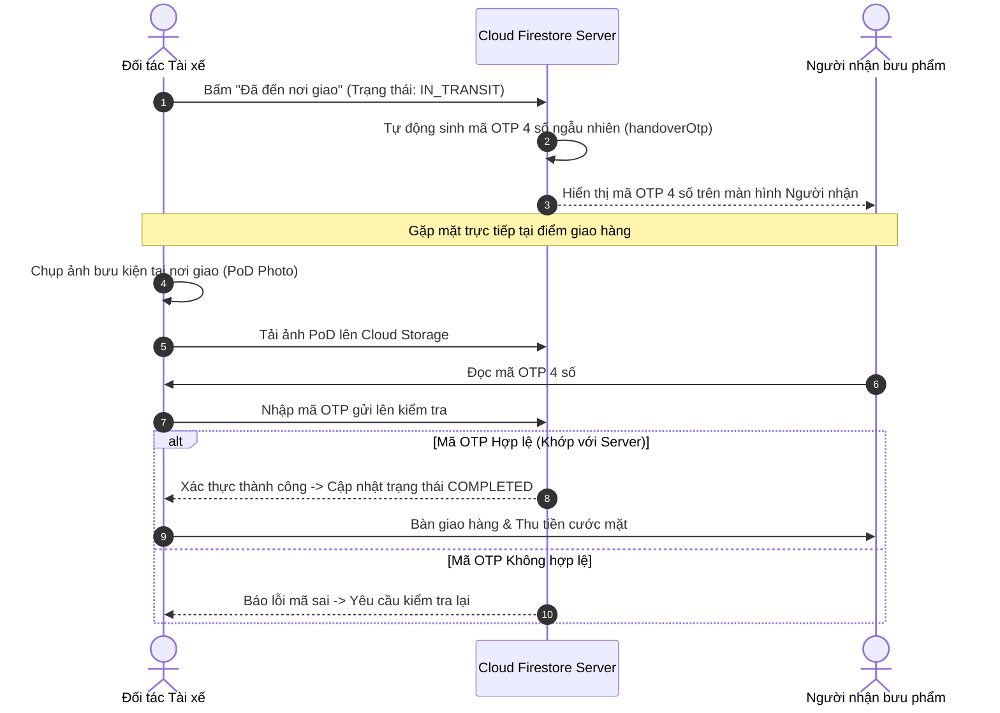

* **Kiến trúc Cổng vào Hợp nhất (UI Entry Point - Welcome Gate):**
  Khi mở ứng dụng, màn hình khởi đầu đóng vai trò bộ điều hướng trung tâm, phân phối người dùng vào 4 cánh cổng chuyên biệt:
  1. 🟢 **Cổng Khách hàng:** Đưa khách vào màn hình bản đồ đặt xe và tạo đơn giao hàng.
  2. 🟡 **Cổng Đối tác Tài xế:** Đưa tài xế vào bảng điều khiển ca làm việc, bật trực tuyến nhận cuốc.
  3. 🟣 **Cổng Đăng ký Đối tác Mới (eKYC):** Khởi động luồng nộp hồ sơ bằng lái và CCCD trực tuyến.
  4. 🔵 **Cổng Quản trị viên (Admin):** Xác thực tài khoản quản trị để mở Bàn cờ Radar toàn thành phố.
* **Cơ chế Demo Role Switcher:** Trên mọi màn hình đều có công tắc chuyển đổi vai trò nhanh, hỗ trợ nhóm kiểm thử kịch bản tương tác chéo giữa 4 thiết bị một cách mượt mà trước Hội đồng bảo vệ.

---

## **2.3. Phân tích Usecase**

### *2.3.1. Biểu đồ Usecase Tổng quát Toàn hệ thống*

*Hình 2.3: Biểu đồ Usecase Tổng quát Toàn hệ thống JetPost*

```mermaid
flowchart TB
    %% Tác nhân cơ sở và các tác nhân kế thừa
    UserActor["👤 Người dùng<br/>(User cơ sở)"]
    Customer["👤 Khách hàng<br/>(Customer)"]
    Driver["👤 Đối tác Tài xế<br/>(Driver)"]
    Admin["👤 Quản trị viên<br/>(Admin)"]

    %% Quan hệ Kế thừa tác nhân (Generalization trong Flowchart)
    Customer -->|Kế thừa| UserActor
    Driver -->|Kế thừa| UserActor
    Admin -->|Kế thừa| UserActor

    subgraph SystemBoundary ["HỆ THỐNG XE CÔNG NGHỆ & GIAO NHẬN JETPOST"]
        %% Usecase Cốt lõi & Dùng chung của Phân hệ User (Trung tâm)
        UC_Register(["Đăng ký tài khoản"])
        UC_Login(["Đăng nhập qua SĐT & OTP"])
        UC_Logout(["Đăng xuất"])
        UC_Profile(["Quản lý hồ sơ cá nhân"])
        UC_Settings(["Cài đặt ứng dụng"])
        UC_Chat(["Nhắn tin trực tiếp P2P"])

        %% Usecase Khách hàng (Nhánh trái)
        UC_BookRide(["Đặt xe ôm công nghệ"])
        UC_CreateDelivery(["Tạo đơn giao hàng nhanh"])
        UC_LiveTrack(["Theo dõi lộ trình Live Tracking"])
        UC_Consignee(["Tra cứu đơn nhận & Lấy OTP"])
        UC_SavedAddress(["Quản lý địa chỉ quen thuộc"])
        UC_History(["Xem lịch sử & Đặt lại chuyến"])
        UC_RateDriver(["Đối soát PoD & Đánh giá"])

        %% Usecase Đối tác Tài xế đã kích hoạt (Nhánh dưới)
        UC_Online(["Bật/Tắt Online & Phát GPS ngầm"])
        UC_AcceptTrip(["Tiếp nhận cuốc xe lân cận 15s"])
        UC_NavMaps(["Dẫn đường Google Maps giọng nói"])
        UC_VerifyPoD(["Bàn giao hàng PoD (Ảnh & OTP)"])
        UC_DriverIncome(["Xem ví thu nhập & Chiết khấu"])

        %% Usecase Quản trị Admin (Nhánh phải)
        UC_RadarMap(["Giám sát Bàn cờ Radar toàn thành phố"])
        UC_ApproveKyc(["Thẩm định phê duyệt eKYC"])
        UC_UserManage(["Quản lý tài khoản (Khóa/Mở)"])
        UC_DisputePoD(["Xử lý tranh chấp & Đối soát PoD"])
        UC_PriceConfig(["Cấu hình biểu cước & Hoa hồng"])
        UC_Analytics(["Xem báo cáo thống kê doanh thu"])
        UC_Broadcast(["Phát thông báo vận hành Broadcast"])

        %% Quan hệ <<include>> bắt buộc Đăng nhập / Xác thực
        UC_BookRide -.->|"<<include>>"| UC_Login
        UC_CreateDelivery -.->|"<<include>>"| UC_Login
        UC_SavedAddress -.->|"<<include>>"| UC_Login
        UC_History -.->|"<<include>>"| UC_Login
        UC_Online -.->|"<<include>>"| UC_Login
        UC_AcceptTrip -.->|"<<include>>"| UC_Login
        UC_DriverIncome -.->|"<<include>>"| UC_Login
        UC_RadarMap -.->|"<<include>>"| UC_Login
        UC_ApproveKyc -.->|"<<include>>"| UC_Login
        UC_UserManage -.->|"<<include>>"| UC_Login
        UC_PriceConfig -.->|"<<include>>"| UC_Login
        UC_Analytics -.->|"<<include>>"| UC_Login
        UC_Profile -.->|"<<include>>"| UC_Login
        UC_Logout -.->|"<<include>>"| UC_Login
    end

    %% Liên kết Tác nhân User cơ sở với Usecase Phân hệ User
    UserActor --- UC_Register
    UserActor --- UC_Login
    UserActor --- UC_Logout
    UserActor --- UC_Profile
    UserActor --- UC_Settings
    UserActor --- UC_Chat

    %% Liên kết Khách hàng với Usecase Khách hàng
    Customer --- UC_BookRide
    Customer --- UC_CreateDelivery
    Customer --- UC_LiveTrack
    Customer --- UC_Consignee
    Customer --- UC_SavedAddress
    Customer --- UC_History
    Customer --- UC_RateDriver

    %% Liên kết Tài xế với Usecase Tài xế
    Driver --- UC_Online
    Driver --- UC_AcceptTrip
    Driver --- UC_NavMaps
    Driver --- UC_VerifyPoD
    Driver --- UC_DriverIncome

    %% Liên kết Admin với Usecase Quản trị
    Admin --- UC_RadarMap
    Admin --- UC_ApproveKyc
    Admin --- UC_UserManage
    Admin --- UC_DisputePoD
    Admin --- UC_PriceConfig
    Admin --- UC_Analytics
    Admin --- UC_Broadcast
```

---

### *2.3.2. Bảng Phân rã Chức năng Chi tiết theo 4 Phân hệ*

| Mã Usecase | Tên Chức năng | Tác nhân chính | Luồng Nghiệp vụ Tóm tắt |
| :--- | :--- | :---: | :--- |
| **UC-1.1** | Đặt xe ôm công nghệ | Khách hàng | Chọn điểm đón/trả -> Tính cước Upfront -> Tạo chuyến `PENDING_DRIVER` -> Quét radar 45s. |
| **UC-1.2** | Tạo đơn giao hàng nhanh | Khách hàng | Nhập tên/SĐT người nhận -> Chọn loại hàng -> Tính cước -> Sinh mã đơn & link tra cứu. |
| **UC-1.3** | Live Tracking GPS | Khách hàng | Cuốc nhận -> Lắng nghe stream GPS tài xế -> Xe máy di chuyển và xoay góc thời gian thực. |
| **UC-1.4** | Tra cứu bưu phẩm gửi cho tôi | Người nhận | Tự động truy vấn đơn theo SĐT người nhận -> Xem Timeline 5 bước -> Lấy mã OTP 4 số. |
| **UC-1.5** | Đối soát PoD & Đánh giá | Khách hàng | Nhận tín hiệu `COMPLETED` -> Xem hóa đơn tiền mặt -> Xem ảnh PoD -> Chấm 1-5 sao tài xế. |
| **UC-1.6** | Địa chỉ quen thuộc | Khách hàng | Lưu Nhà riêng, Cơ quan vào Firestore -> Hiển thị Quick Chips đặt xe siêu tốc 1 chạm. |
| **UC-1.7** | Lịch sử & Đặt lại | Khách hàng | Xem lại cuốc cũ -> Xem ảnh PoD -> Đánh giá bù -> Bấm "Đặt lại chuyến này" tự điền điểm. |
| **UC-2.1** | Bật Online phát GPS ngầm | Tài xế | Gạt công tắc Online -> Chạy Android Foreground Service -> Cập nhật Geohash mỗi khi đi 15m. |
| **UC-2.2** | Nhận cuốc xe lân cận | Tài xế | Chuông rung thông báo -> Hiện pop-up thông tin cuốc + đếm ngược 15s -> Bấm Nhận hoặc Bỏ qua. |
| **UC-2.3** | Dẫn đường Google Maps | Tài xế | Bấm icon Maps -> Deep-link mở Google Maps gốc dẫn đường Turn-by-turn bằng giọng nói. |
| **UC-2.4** | Bàn giao hàng an toàn PoD | Tài xế | Đến điểm giao -> Chụp ảnh gói hàng tại địa chỉ -> Nhập mã OTP người nhận cung cấp -> Hoàn tất. |
| **UC-2.5** | Ẩn số điện thoại khách | Tài xế | Số điện thoại hiển thị `098***5678` -> Bấm gọi kích hoạt trình quay số ẩn danh của máy. |
| **UC-2.6** | Ví thu nhập tài xế | Tài xế | Xem doanh thu ngày/tuần, trừ chiết khấu hoa hồng hệ thống, xem số tiền mặt thực nhận. |
| **UC-3.1** | UI Entry Point Gate | User / Chung | Màn hình cổng vào chào đón, chọn 1 trong 4 cổng làm việc, hỗ trợ Demo Switcher đổi vai trò. |
| **UC-3.2** | Phone Auth OTP Đa tầng | User / Chung | Chuẩn hóa E.164, Regex đầu số VN, Firebase gửi SMS OTP 6 số, đếm ngược 60s chống spam. |
| **UC-3.3** | Đăng ký eKYC trở thành tài xế | Người dùng (User) | Chụp ảnh CCCD (2 mặt) và GPLX -> Nén ảnh tải lên Storage -> Chuyển trạng thái `PENDING_APPROVAL`. |
| **UC-3.4** | Quản lý Hồ sơ cá nhân | User / Chung | Xem/sửa thông tin cá nhân, cập nhật Avatar, tính năng đổi số điện thoại có xác minh OTP. |
| **UC-3.5** | Phân quyền RBAC & Phiên | User / Chung | Router Guard kiểm tra quyền role, chặn tài xế chưa duyệt bật online, lưu phiên tự động đăng nhập. |
| **UC-3.6** | Cài đặt Giao diện Sáng/Tối | User / Chung | Đổi Theme Dark Mode giảm chói mắt ban đêm, bật/tắt âm thanh chuông báo nhận cuốc. |
| **UC-3.7** | Nhắn tin Trực tiếp P2P | User / Chung | Chat 1-1 tự do giữa 2 user bất kỳ qua Firestore Stream, hộp thư hội thoại, lưu trữ vĩnh viễn. |
| **UC-4.1** | Đăng nhập Quản trị viên | Admin | Xác thực mật khẩu và mã quản trị viên cấp cao, Router Guard khóa chặt màn hình điều hành. |
| **UC-4.2** | Bàn cờ Radar toàn cảnh | Admin | Bản đồ toàn thành phố hiển thị marker xe tài xế online thời gian thực và các điểm cuốc chờ. |
| **UC-4.3** | Thẩm định eKYC tài xế | Admin | Xem chi tiết ảnh CCCD, GPLX, biển số xe máy -> Bấm nút "Phê duyệt" kích hoạt chạy xe hoặc "Từ chối". |
| **UC-4.4** | Quản lý Người dùng & Xe | Admin | Danh sách khách hàng và đối tác tài xế -> Xem lịch sử vi phạm -> Lệnh Khóa/Mở khóa tài khoản. |
| **UC-4.5** | Xử lý Tranh chấp PoD | Admin | Mở hồ sơ khiếu nại -> Đối chiếu tọa độ lúc giao, ảnh PoD của tài xế và thời gian nhập OTP. |
| **UC-4.6** | Cấu hình Biểu cước | Admin | Chỉnh sửa giá mở cửa, giá/km, % hoa hồng chiết khấu -> Lưu Firestore đồng bộ tức thì toàn app. |
| **UC-4.7** | Báo cáo Thống kê Analytics | Admin | Biểu đồ đường doanh thu theo ngày/tháng, biểu đồ tròn tỷ lệ cuốc thành công/hủy, số user mới. |
| **UC-4.8** | Phát Thông báo Broadcast | Admin | Soạn tin khẩn cấp -> Chọn đối tượng (Tài xế/Khách/Tất cả) -> Bắn thông báo đẩy tức thì toàn mạng. |

---

### *2.3.3. Phân rã Chi tiết Usecase & Biểu đồ Tuần tự Phân hệ Khách hàng (Customer Module)*

Dưới đây là đặc tả chi tiết và biểu đồ tuần tự (Sequence Diagram) theo mô hình kiến trúc phân lớp chuẩn `Actor -> View -> Controller/Service -> Model -> Database` cho toàn bộ 7 Usecase thuộc Phân hệ Khách hàng:

---

#### **1. UC-1.1: Đặt xe ôm công nghệ (Ride Booking & Upfront Pricing)**

##### *A. Bảng Đặc tả Usecase*

| Thuộc tính | Nội dung chi tiết |
| :--- | :--- |
| **Mô tả** | Cho phép khách hàng chọn điểm đón, điểm đến trên bản đồ, xem trước lộ trình, ước tính khoảng cách, chốt giá cước cố định (Upfront Pricing) và tạo yêu cầu tìm tài xế xe ôm lân cận. |
| **Tác nhân** | Khách hàng (Customer) |
| **Điều kiện kích hoạt** | Khách hàng đã đăng nhập tài khoản vào ứng dụng và bật quyền truy cập vị trí (GPS). |
| **Luồng sự kiện chính** | 1. Khách hàng mở màn hình Đặt xe, chọn điểm đón (mặc định lấy GPS hiện tại) và nhập địa chỉ điểm đến. 2. Giao diện (View) gửi tọa độ điểm đón và điểm trả sang Controller (`CustomerService`). 3. Controller gọi OpenRouteService API tính toán lộ trình Polyline và khoảng cách di chuyển thực tế (km). 4. Controller đọc biểu cước từ Model cấu hình hệ thống, tính giá cước cố định: `Giá = Giá mở cửa + Quãng đường * Giá/km`. 5. View hiển thị tuyến đường vẽ trên bản đồ OpenStreetMap cùng bảng chốt giá cước cố định. 6. Khách hàng xác nhận "Đặt chuyến ngay". 7. Controller tạo đối tượng `RideModel` với trạng thái `PENDING_DRIVER` và lưu bản ghi vào Collection `rides` trên Cloud Firestore Database. 8. Database phản hồi kết quả lưu thành công. 9. View chuyển sang giao diện quét radar tìm tài xế với hiệu ứng sóng lan tỏa và đếm ngược 45 giây. |
| **Luồng sự kiện ngoại lệ** | - **Không tìm thấy tuyến đường kết nối:** OpenRouteService không trả về Polyline -> View hiển thị thông báo lỗi: *"Không tìm thấy đường đi giữa hai điểm đã chọn, vui lòng kiểm tra lại điểm đón/trả"*, giữ nguyên màn hình chọn điểm. - **Hết thời gian quét radar 45s không có tài xế nhận:** Controller kích hoạt hủy chuyến tự động, cập nhật trạng thái `CANCELLED_TIMEOUT` lên Database -> View hiển thị thông báo: *"Hiện tất cả tài xế quanh khu vực đều đang bận, bạn có muốn thử quét lại không?"*. |
| **Đảm bảo thành công** | Chuyến đi được tạo thành công trên hệ thống với mã định danh duy nhất, trạng thái `PENDING_DRIVER`, dữ liệu hiển thị tức thì trên radar của các tài xế lân cận. |

##### *B. Biểu đồ Tuần tự (Sequence Diagram)*

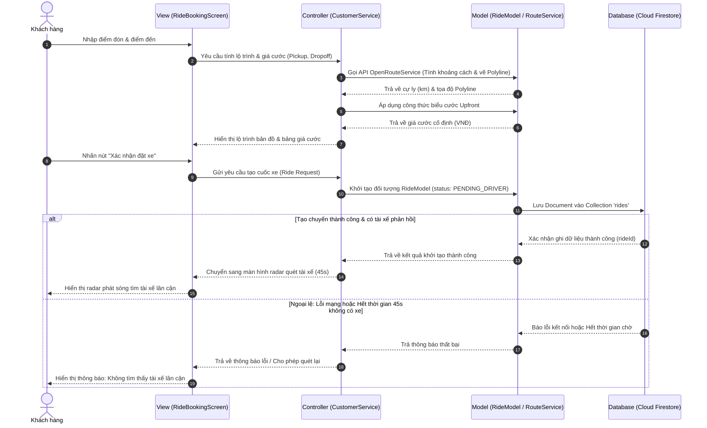

---

#### **2. UC-1.2: Tạo đơn giao hàng nhanh (Express Delivery Booking)**

##### *A. Bảng Đặc tả Usecase*

| Thuộc tính | Nội dung chi tiết |
| :--- | :--- |
| **Mô tả** | Khách hàng tạo yêu cầu giao hàng nhanh, nhập thông tin người nhận hàng (Họ tên, SĐT), lựa chọn loại bưu kiện, tính toán cước phí và tạo đơn hàng an toàn kích hoạt cơ chế bảo vệ PoD. |
| **Tác nhân** | Khách hàng / Người gửi (Sender) |
| **Điều kiện kích hoạt** | Khách hàng đã đăng nhập tài khoản vào ứng dụng. |
| **Luồng sự kiện chính** | 1. Khách hàng mở tab Giao hàng, nhập thông tin Người nhận (Tên, SĐT), địa chỉ gửi và địa chỉ nhận. 2. Chọn phân loại hàng hóa (Tài liệu, Thực phẩm, Đồ điện tử, Hàng thời trang) và ghi chú cho tài xế. 3. Giao diện (View) gửi dữ liệu sang Controller (`DeliveryService`). 4. Controller kiểm tra tính hợp lệ của Số điện thoại người nhận (Regex chuẩn mạng Việt Nam). 5. Controller tính khoảng cách và xác định cước vận chuyển bưu phẩm. 6. View hiển thị tóm tắt vận đơn và tổng cước phí. 7. Khách hàng nhấn "Tạo đơn giao hàng". 8. Controller đóng gói `DeliveryModel` với trạng thái `PENDING_DRIVER`, thiết lập cờ bảo mật PoD. 9. Model ghi dữ liệu vào Collection `deliveries` trên Cloud Firestore Database. 10. Database xác nhận tạo đơn thành công, hệ thống sinh mã vận đơn duy nhất (Tracking ID). 11. View hiển thị thông báo đặt đơn giao hàng thành công và chuyển vào màn hình theo dõi đơn hàng. |
| **Luồng sự kiện ngoại lệ** | - **Số điện thoại người nhận không hợp lệ:** Người dùng nhập SĐT sai độ dài hoặc đầu số không tồn tại -> View báo lỗi ngay tại trường nhập liệu: *"Số điện thoại người nhận không đúng định dạng mạng Việt Nam"*, không cho phép gửi yêu cầu. - **Địa chỉ giao nhận trùng lặp:** Điểm gửi và nhận cách nhau dưới 50m -> View cảnh báo: *"Điểm lấy hàng và giao hàng quá gần nhau, vui lòng kiểm tra lại"*. |
| **Đảm bảo thành công** | Đơn giao hàng được lưu trên Cloud Firestore, sinh mã vận đơn duy nhất, kích hoạt sẵn sàng liên kết với màn hình tra cứu của người nhận. |

##### *B. Biểu đồ Tuần tự (Sequence Diagram)*

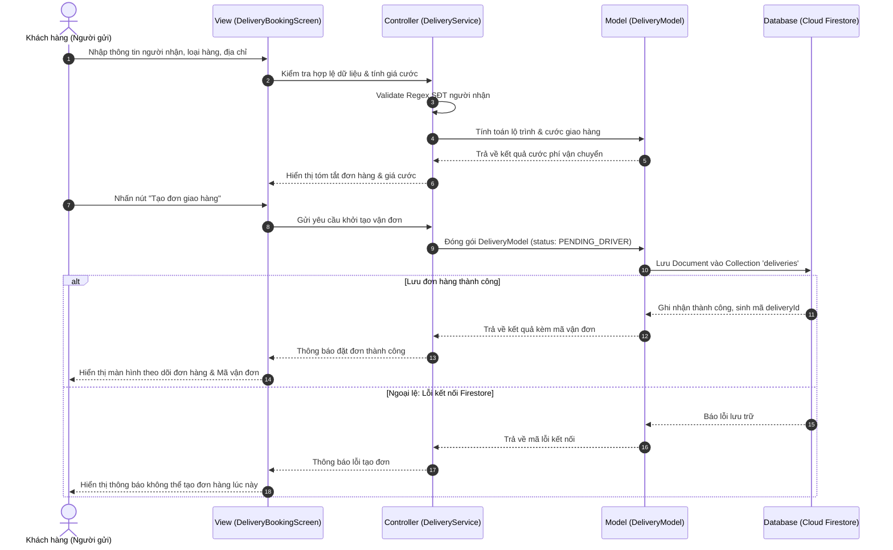

---

#### **3. UC-1.3: Theo dõi lộ trình thời gian thực (Live Tracking GPS)**

##### *A. Bảng Đặc tả Usecase*

| Thuộc tính | Nội dung chi tiết |
| :--- | :--- |
| **Mô tả** | Khách hàng theo dõi vị trí di chuyển trực tiếp của tài xế trên bản đồ số, góc xoay xe máy (Bearing), thời gian dự kiến đến (ETA) và tình trạng chuyến xe theo thời gian thực mà không cần tải lại trang. |
| **Tác nhân** | Khách hàng (Customer) |
| **Điều kiện kích hoạt** | Chuyến xe hoặc đơn giao hàng đã được tài xế tiếp nhận (`status` chuyển thành `ACCEPTED` hoặc `IN_TRANSIT`). |
| **Luồng sự kiện chính** | 1. Khi cuốc xe được nhận, View tự động mở màn hình `LiveTrackingScreen`. 2. View kích hoạt Controller mở một luồng lắng nghe thời gian thực (`StreamSubscription`). 3. Controller kết nối đến Document tài xế trong Collection `drivers` và chuyến đi trong Collection `rides`. 4. Database liên tục đẩy dữ liệu tọa độ mới (`currentLat`, `currentLng`, `bearing`) mỗi khi tài xế di chuyển. 5. Model phân tích tọa độ và cập nhật trạng thái chuyến đi. 6. Controller đẩy dữ liệu vị trí về View. 7. View mượt mà di chuyển Marker biểu tượng xe máy trên bản đồ OpenStreetMap, xoay đầu xe theo góc la bàn và tính toán lại thời gian dự kiến đến (ETA). 8. Khách hàng theo dõi tài xế cho đến khi tài xế đến điểm đón hoặc điểm giao. |
| **Luồng sự kiện ngoại lệ** | - **Mất kết nối mạng Internet:** Thiết bị khách hàng mất sóng 4G/Wifi -> View hiển thị biểu tượng cảnh báo: *"Đang kết nối lại GPS..."* và giữ nguyên vị trí xe máy cuối cùng ghi nhận. - **Tài xế hủy chuyến bất ngờ:** Database phát tín hiệu trạng thái chuyến đổi thành `CANCELLED_BY_DRIVER` -> Controller hủy Stream -> View hiển thị Pop-up thông báo: *"Tài xế đã hủy chuyến do sự cố kỹ thuật"* và tự động kích hoạt điều phối xe khác. |
| **Đảm bảo thành công** | Vị trí tài xế được hiển thị mượt mà liên tục với độ trễ dưới 2 giây, trạng thái chuyến đi luôn được đồng bộ chính xác. |

##### *B. Biểu đồ Tuần tự (Sequence Diagram)*

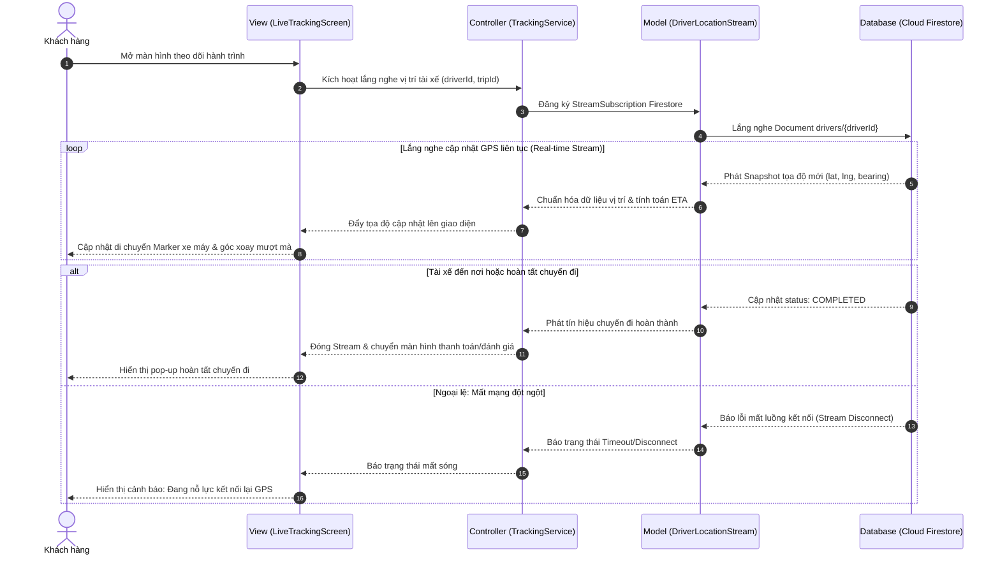

---

#### **4. UC-1.4: Tra cứu bưu phẩm gửi cho tôi & Lấy mã OTP bàn giao (Consignee Tracking & OTP)**

##### *A. Bảng Đặc tả Usecase*

| Thuộc tính | Nội dung chi tiết |
| :--- | :--- |
| **Mô tả** | Người nhận bưu phẩm tra cứu tự động các đơn hàng đang trên đường giao tới mình thông qua số điện thoại, theo dõi Timeline 5 giai đoạn vận đơn và lấy mã xác thực OTP 4 số để cung cấp cho tài xế khi nhận hàng. |
| **Tác nhân** | Người nhận bưu phẩm (Consignee / Receiver) |
| **Điều kiện kích hoạt** | Người nhận cài ứng dụng JetPost và đăng nhập bằng đúng số điện thoại người nhận hàng. |
| **Luồng sự kiện chính** | 1. Người nhận mở tab "Đơn nhận của tôi" (`ConsigneeScreen`). 2. Giao diện (View) gửi yêu cầu tra cứu tới Controller theo `user.phone`. 3. Controller gọi Model truy vấn Database lọc các bản ghi trong Collection `deliveries` có `receiverPhone == user.phone` và trạng thái khác `COMPLETED`. 4. Database trả về danh sách các vận đơn gửi tới người nhận. 5. View hiển thị danh sách gói hàng đang giao kèm thanh tiến trình trực quan (Timeline 5 bước: Khởi tạo -> Đã nhận đơn -> Đang lấy hàng -> Đang giao -> Đã giao). 6. Khi tài xế bấm "Đã đến nơi giao", trạng thái cập nhật trên Database. 7. View tự động hiển thị Hộp nổi bật chứa **Mã OTP bàn giao 4 số** (`handoverOtp`). 8. Người nhận đọc mã OTP này cho tài xế khi gặp mặt nhận bưu kiện. |
| **Luồng sự kiện ngoại lệ** | - **Không có bưu phẩm nào đang gửi tới:** Database trả về danh sách rỗng -> View hiển thị giao diện minh họa trống (Empty State): *"Hiện tại không có đơn bưu phẩm nào đang gửi tới số điện thoại này"*, kèm nút bấm tra cứu lại. |
| **Đảm bảo thành công** | Người nhận nắm rõ lịch trình gói hàng, nhận diện đúng tài xế giao và sở hữu mã bí mật OTP 4 số để bảo vệ kiện hàng. |

##### *B. Biểu đồ Tuần tự (Sequence Diagram)*

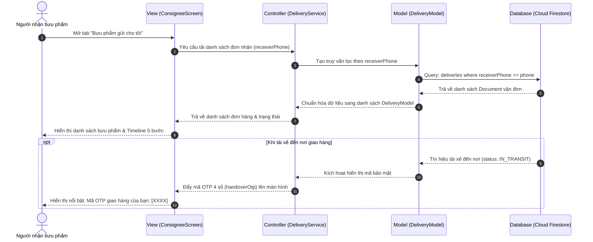

---

#### **5. UC-1.5: Đối soát bằng chứng PoD & Đánh giá chất lượng (PoD Inspection & Rating)**

##### *A. Bảng Đặc tả Usecase*

| Thuộc tính | Nội dung chi tiết |
| :--- | :--- |
| **Mô tả** | Sau khi chuyến đi hoặc đơn hàng hoàn tất, khách hàng xem tóm tắt hóa đơn cước tiền mặt, kiểm tra ảnh chụp bằng chứng giao hàng (PoD Photo) của tài xế và gửi đánh giá từ 1 đến 5 sao kèm nhận xét chất lượng phục vụ. |
| **Tác nhân** | Khách hàng (Customer) |
| **Điều kiện kích hoạt** | Đơn hàng hoặc cuốc xe vừa hoàn tất chuyển sang trạng thái `COMPLETED`. |
| **Luồng sự kiện chính** | 1. Hệ thống phát tín hiệu cuốc xe hoàn tất, View hiển thị màn hình hóa đơn & đánh giá (`RatingPoDScreen`). 2. View tải tóm tắt chi phí cuốc xe và ảnh chụp thực tế bằng chứng giao hàng PoD từ Controller. 3. Controller gọi Model lấy `podPhotoUrl` từ Cloud Storage/Firestore. 4. Khách hàng kiểm tra ảnh PoD chụp gói hàng tại cửa nhà. 5. Khách hàng chọn số sao đánh giá (1 - 5 sao) và chọn các thẻ nhận xét nhanh (Ví dụ: "Lái xe an toàn", "Nhiệt tình", "Đúng giờ"). 6. Khách hàng nhấn nút "Gửi đánh giá". 7. Controller gửi dữ liệu đánh giá tới Model. 8. Model cập nhật điểm đánh giá vào cuốc xe trong Collection `rides`/`deliveries` và kích hoạt tính lại điểm uy tín trung bình (Average Rating) của tài xế trong Collection `drivers`. 9. Database phản hồi kết quả cập nhật thành công. 10. View hiển thị thông báo cảm ơn và tự động điều hướng khách hàng về lại màn hình chính. |
| **Luồng sự kiện ngoại lệ** | - **Khách hàng không đánh giá (Bấm bỏ qua):** Người dùng nhấn nút "Để sau / Đóng" -> View ghi nhận bỏ qua, chuyến đi vẫn giữ trạng thái đã hoàn thành và trở về màn hình chính. - **Lỗi đường truyền khi gửi đánh giá:** Mất kết nối khi bấm gửi -> View lưu tạm đánh giá vào bộ nhớ máy và hiện thông báo: *"Chưa gửi được đánh giá, hệ thống sẽ tự động đồng bộ khi có mạng"*. |
| **Đảm bảo thành công** | Bằng chứng PoD được minh bạch với khách hàng, điểm sao đánh giá được ghi nhận chính xác vào hồ sơ tài xế. |

##### *B. Biểu đồ Tuần tự (Sequence Diagram)*

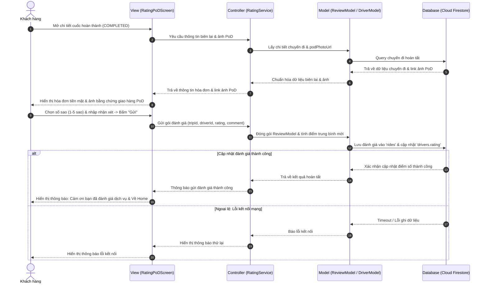

---

#### **6. UC-1.6: Quản lý địa chỉ quen thuộc (Saved Places)**

##### *A. Bảng Đặc tả Usecase*

| Thuộc tính | Nội dung chi tiết |
| :--- | :--- |
| **Mô tả** | Cho phép khách hàng quản lý danh sách các địa chỉ thường xuyên lui tới (Nhà riêng, Cơ quan, Trường học), phục vụ đặt xe và giao hàng siêu tốc 1 chạm mà không cần gõ lại địa chỉ. |
| **Tác nhân** | Khách hàng (Customer) |
| **Điều kiện kích hoạt** | Khách hàng đã đăng nhập tài khoản vào ứng dụng. |
| **Luồng sự kiện chính** | 1. Khách hàng vào mục "Địa chỉ đã lưu" trên trang cá nhân hoặc nhấn biểu tượng Thêm địa chỉ trên màn hình chính. 2. View hiển thị danh sách địa chỉ đã lưu (kèm nhãn: Home, Work, Khác). 3. Khách hàng chọn "Thêm địa chỉ mới", tìm kiếm địa chỉ trên bản đồ hoặc nhập thanh tìm kiếm. 4. Khách hàng đặt nhãn (Ví dụ: "Nhà riêng", "Công ty") và xác nhận lưu. 5. View gửi dữ liệu địa chỉ sang Controller (`CustomerService`). 6. Controller chuyển dữ liệu cho Model. 7. Model ghi một Document mới vào Sub-collection `users/{uid}/saved_addresses` trên Cloud Firestore Database. 8. Database xác nhận lưu thành công. 9. View cập nhật lại danh sách địa chỉ và hiển thị các phím tắt nhanh (Quick Chips) ngay tại trang chủ để phục vụ đặt xe 1 chạm. |
| **Luồng sự kiện ngoại lệ** | - **Xóa địa chỉ đã lưu:** Khách hàng vuốt sang trái để xóa -> View hiện pop-up xác nhận -> Controller gửi lệnh xóa Document khỏi Sub-collection `saved_addresses` -> Database cập nhật và View bỏ hiển thị nhãn địa chỉ đó. |
| **Đảm bảo thành công** | Địa chỉ quen thuộc được lưu trữ an toàn theo UID của khách hàng, hiển thị tức thì trên các thanh gợi ý tìm đường. |

##### *B. Biểu đồ Tuần tự (Sequence Diagram)*

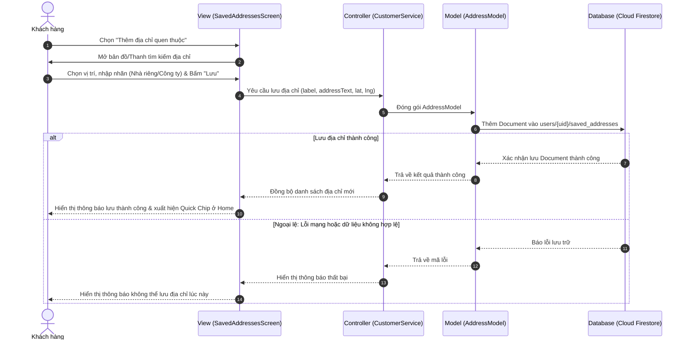

---

#### **7. UC-1.7: Lịch sử chuyến đi & Đặt lại chuyến 1 chạm (Ride History & Reorder)**

##### *A. Bảng Đặc tả Usecase*

| Thuộc tính | Nội dung chi tiết |
| :--- | :--- |
| **Mô tả** | Cung cấp trung tâm tra cứu toàn bộ các chuyến xe ôm và đơn giao hàng đã thực hiện trong quá khứ, hỗ trợ xem lại hóa đơn, xem ảnh bằng chứng PoD và tính năng "Đặt lại chuyến này" (Re-order) tự động điền lộ trình chỉ bằng 1 chạm. |
| **Tác nhân** | Khách hàng (Customer) |
| **Điều kiện kích hoạt** | Khách hàng đã đăng nhập tài khoản vào ứng dụng. |
| **Luồng sự kiện chính** | 1. Khách hàng chuyển sang tab "Hoạt động / Lịch sử chuyến đi" (`ActivityHistoryScreen`). 2. View gửi yêu cầu tải danh sách cuốc xe theo `customerId` tới Controller. 3. Controller gọi Model thực hiện truy vấn trên Cloud Firestore sắp xếp theo `createdAt` giảm dần (mới nhất lên đầu). 4. Database trả về danh sách lịch sử cuốc xe. 5. View hiển thị danh sách cuốc với đầy đủ trạng thái trực quan (Hoàn thành, Đã hủy), thời gian, tên tài xế và số tiền cước. 6. Khách hàng bấm vào một chuyến đi cũ để xem chi tiết biên lai và ảnh PoD. 7. Khách hàng nhấn nút **"Đặt lại chuyến này"** (Re-order). 8. Controller tự động lấy lại thông tin điểm đón, điểm trả của cuốc xe cũ, nạp thẳng vào màn hình Đặt xe mới và kích hoạt tính giá cước hiện tại. 9. View mở màn hình xác nhận đặt chuyến với lộ trình được điền sẵn 100%. |
| **Luồng sự kiện ngoại lệ** | - **Chưa từng có cuốc xe nào:** Lịch sử trống -> View hiển thị hình ảnh minh họa thân thiện: *"Bạn chưa có chuyến đi nào cùng JetPost. Hãy đặt chuyến đầu tiên ngay hôm nay!"* kèm nút "Đặt xe ngay". |
| **Đảm bảo thành công** | Khách hàng kiểm tra minh bạch lịch sử chi tiêu di chuyển và tiết kiệm tối đa thao tác đặt lại chuyến quen thuộc hàng ngày. |

##### *B. Biểu đồ Tuần tự (Sequence Diagram)*

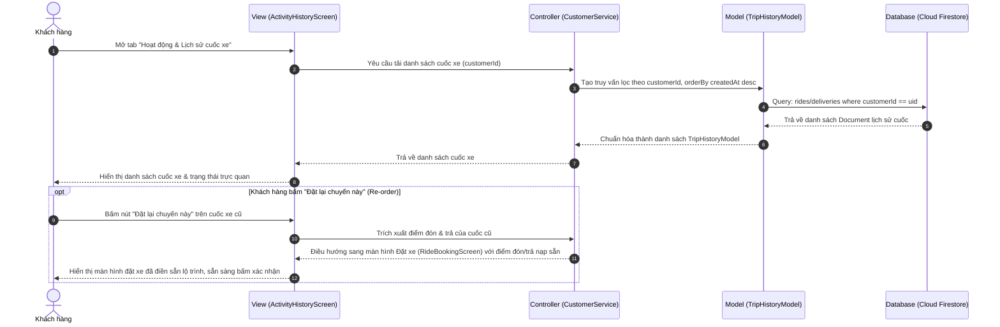

---

## **2.4. Thiết kế Điều hướng (Navigation Flow) & Cấu trúc Widget (Widget Tree)**

*Hình 2.4: Sơ đồ Điều hướng & Cây Widget Ứng dụng (Widget Tree & Routing)*

```mermaid
graph TD
    ROOT["MaterialApp (jet_post)"] --> THEME["Theme & Localization (Dark/Light)"]
    ROOT --> GATE["WelcomeGateScreen (Cổng vào Hợp nhất)"]
    GATE -.-> SWITCHER["Demo Role Switcher Widget"]

    GATE --> CUST["Cổng Khách hàng (CustomerGate)"]
    CUST --> CUST_MAIN["CustomerMainScreen (BottomNavBar: 3 Tabs)"]
    CUST_MAIN --> TAB1["Tab Đặt xe & Giao hàng"]
    TAB1 --> MAP["MapWidget (OpenStreetMap)"]
    TAB1 --> CHIPS["SavedAddressChips (Nhà riêng/Cơ quan)"]
    TAB1 --> CONFIRM["RideConfirmSheet (Upfront Price)"]
    CONFIRM --> TRACK["LiveTrackingScreen & RatingPoDModal"]
    CUST_MAIN --> TAB2["Tab Tra cứu Đơn nhận (OTP 4 số)"]
    CUST_MAIN --> TAB3["Tab Hoạt động & Lịch sử (Re-order)"]

    GATE --> DRIV["Cổng Đối tác Tài xế (DriverGate)"]
    DRIV --> DRIV_MAIN["DriverMainScreen"]
    DRIV_MAIN --> ONSWITCH["OnlineSwitchBar (Foreground GPS Service)"]
    DRIV_MAIN --> OFFER["DispatchOfferModal (Pop-up nhận đơn 15s)"]
    DRIV_MAIN --> TRIP["DriverTripScreen (Máy trạng thái)"]
    TRIP --> NAV["GoogleMapsButton (Deep-link giọng nói)"]
    TRIP --> POD["PoDVerificationSheet (Ảnh + OTP)"]
    DRIV_MAIN --> INC["DriverIncomeScreen (Ví thu nhập)"]

    GATE --> USER["Cổng User & Hạ tầng (UserGate)"]
    USER --> AUTH["PhoneAuthScreen (SMS OTP 6 số)"]
    USER --> KYC["DriverKycScreen (CCCD & GPLX Camera)"]
    USER --> PROF["ProfileScreen (Họ tên, Avatar)"]
    USER --> SETT["AppSettingsScreen (Dark/Light Mode)"]
    USER --> INBOX["MessagesInboxScreen (Hộp thư P2P)"]
    INBOX --> CHAT["DirectChatScreen (Bong bóng 2 chiều)"]

    GATE --> ADM["Cổng Quản trị Admin (AdminGate - Guard)"]
    ADM --> ADM_DASH["AdminDashboardScreen"]
    ADM_DASH --> RADAR["RadarMapScreen (Bàn cờ toàn cảnh)"]
    ADM_DASH --> AKYC["KycApprovalScreen (Duyệt hồ sơ)"]
    ADM_DASH --> AUSER["UsersManagementScreen (Khóa/Mở)"]
    ADM_DASH --> ADISP["DisputePoDScreen (Khiếu nại)"]
    ADM_DASH --> APRIC["PricingConfigScreen (Biểu cước)"]
    ADM_DASH --> ANLY["AnalyticsReportScreen (Doanh thu)"]
    ADM_DASH --> ANOTI["BroadcastNotificationScreen (Báo bão)"]
```

---

## **2.5. Thiết kế Cơ sở dữ liệu (Cloud Firestore Data Schema)**

*Hình 2.5: Lược đồ Thực thể Cơ sở Dữ liệu NoSQL Cloud Firestore (Mermaid ER Diagram)*

```mermaid
erDiagram
    USERS {
        string id PK "Firebase Auth UID"
        string phone "Số điện thoại E.164"
        string fullName "Họ và tên"
        string avatarUrl "Ảnh đại diện Storage"
        string role "customer | driver | admin"
        boolean isBanned "Khóa tài khoản vi phạm"
        timestamp createdAt "Thời điểm tạo"
        timestamp updatedAt "Thời điểm cập nhật"
    }

    DRIVERS {
        string id PK "Trùng với USERS.id"
        string vehicleType "Loại xe (motorcycle)"
        string plateNumber "Biển số xe"
        string idCardFrontUrl "CCCD mặt trước Storage"
        string idCardBackUrl "CCCD mặt sau Storage"
        string licenseUrl "GPLX xe máy Storage"
        string status "PENDING_APPROVAL | ACTIVE | BANNED"
        boolean isOnline "Trạng thái trực tuyến nhận cuốc"
        double currentLat "Tọa độ vĩ độ GPS"
        double currentLng "Tọa độ kinh độ GPS"
        string geohash "Mã Geohash lân cận"
        double heading "Góc xoay la bàn 0-360 độ"
        double rating "Điểm sao uy tín trung bình"
        int totalReviews "Số lượt khách đã đánh giá"
        int totalTrips "Tổng số cuốc xe hoàn thành"
        double walletBalance "Số dư ví thu nhập thực"
        timestamp lastActiveAt "Mốc phát GPS gần nhất"
    }

    SAVED_ADDRESSES {
        string id PK "Auto ID địa chỉ"
        string userId FK "Liên kết USERS.id"
        string label "Nhà riêng | Cơ quan | Khác"
        string addressText "Địa chỉ chữ hiển thị"
        double lat "Vĩ độ địa chỉ"
        double lng "Kinh độ địa chỉ"
        timestamp createdAt "Thời điểm lưu"
    }

    RIDES {
        string id PK "Mã chuyến đi Auto ID"
        string customerId FK "UID khách đặt xe"
        string customerName "Họ tên khách hàng"
        string customerPhone "SĐT liên lạc của khách"
        string driverId FK "UID tài xế nhận chở"
        string driverName "Họ tên tài xế"
        string driverPhone "SĐT liên lạc tài xế"
        string driverPlate "Biển số xe máy đón khách"
        string pickupAddress "Tên địa chỉ điểm đón"
        double pickupLat "Vĩ độ điểm đón"
        double pickupLng "Kinh độ điểm đón"
        string dropoffAddress "Tên địa chỉ điểm trả"
        double dropoffLat "Vĩ độ điểm trả"
        double dropoffLng "Kinh độ điểm trả"
        string pickupGeohash "Mã Geohash quét tài xế"
        double distanceKm "Quãng đường tính toán km"
        double price "Cước tiền mặt cố định"
        double systemFee "Hoa hồng chiết khấu hệ thống"
        double driverIncome "Thu nhập thực nhận của tài xế"
        string status "PENDING_DRIVER | ACCEPTED | IN_TRANSIT | COMPLETED | CANCELLED"
        string cancelReason "Lý do hủy nếu phát sinh"
        string cancelledBy "customer | driver | system"
        int rating "Chấm sao uy tín 1-5 sao"
        string reviewComment "Đánh giá nhận xét chuyến đi"
        timestamp createdAt "Thời điểm tạo cuốc xe"
        timestamp acceptedAt "Thời điểm tài xế nhận"
        timestamp completedAt "Thời điểm kết thúc chuyến"
    }

    DELIVERIES {
        string id PK "Mã vận đơn bưu phẩm"
        string senderId FK "UID người gửi hàng"
        string senderName "Họ tên người gửi"
        string senderPhone "SĐT người gửi"
        string receiverName "Họ tên người nhận"
        string receiverPhone "SĐT người nhận tra cứu"
        string driverId FK "UID tài xế vận chuyển"
        string driverName "Họ tên tài xế giao"
        string driverPhone "SĐT tài xế giao"
        string driverPlate "Biển số xe máy giao hàng"
        string pickupAddress "Địa chỉ lấy bưu kiện"
        double pickupLat "Vĩ độ lấy hàng"
        double pickupLng "Kinh độ lấy hàng"
        string dropoffAddress "Địa chỉ giao bưu kiện"
        double dropoffLat "Vĩ độ giao hàng"
        double dropoffLng "Kinh độ giao hàng"
        string pickupGeohash "Mã Geohash quét xe giao"
        double distanceKm "Quãng đường giao hàng km"
        double price "Cước giao hàng tiền mặt"
        double systemFee "Hoa hồng chiết khấu hệ thống"
        double driverIncome "Thu nhập tài xế thực nhận"
        string packageType "DOCUMENT | FOOD | ELECTRONICS | OTHER"
        string packageNotes "Ghi chú bưu phẩm dễ vỡ"
        string handoverOtp "Mã OTP 4 số bàn giao an toàn"
        string podPhotoUrl "Ảnh chụp bằng chứng PoD"
        string status "PENDING_DRIVER | ACCEPTED | IN_TRANSIT | COMPLETED | CANCELLED"
        string cancelReason "Lý do hủy vận đơn"
        string cancelledBy "customer | driver | system"
        int rating "Chấm sao chất lượng giao hàng"
        string reviewComment "Nhận xét của người gửi"
        timestamp createdAt "Thời điểm tạo vận đơn"
        timestamp acceptedAt "Thời điểm tài xế tiếp nhận"
        timestamp deliveredAt "Thời điểm giao hoàn tất PoD"
    }

    CONVERSATIONS {
        string id PK "uid1_uid2 sắp xếp alphabet"
        array participants "Danh sách 2 UID tham gia"
        map participantDetails "Tên và avatar của 2 bên"
        string lastMessage "Trích đoạn tin nhắn gần nhất"
        string lastSenderId "UID người gửi tin cuối"
        map unreadCount "Số tin chưa đọc của mỗi bên"
        timestamp updatedAt "Mốc cập nhật tin nhắn mới"
    }

    MESSAGES {
        string id PK "Mã tin nhắn Auto ID"
        string conversationId FK "Liên kết CONVERSATIONS.id"
        string senderId "UID người gửi tin"
        string receiverId "UID người nhận tin"
        string content "Nội dung văn bản tin nhắn"
        boolean isRead "Trạng thái đã xem tin"
        timestamp timestamp "Thời điểm gửi tin"
    }

    SYSTEM_SETTINGS {
        string documentId PK "global_config"
        double basePriceRide "Giá mở cửa xe ôm VNĐ"
        double pricePerKmRide "Giá mỗi km xe ôm VNĐ"
        double basePriceDelivery "Giá mở cửa giao hàng VNĐ"
        double pricePerKmDelivery "Giá mỗi km giao hàng VNĐ"
        double commissionRate "Tỷ lệ hoa hồng chiết khấu"
        double maxSearchRadiusKm "Bán kính quét radar km"
        int driverAcceptTimeoutSeconds "Đếm ngược nhận cuốc 15s"
        int radarSearchTimeoutSeconds "Đếm ngược quét xe 45s"
        timestamp updatedAt "Thời điểm cập nhật biểu cước"
        string updatedBy "UID quản trị viên điều chỉnh"
    }

    SYSTEM_NOTIFICATIONS {
        string id PK "Mã thông báo Auto ID"
        string title "Tiêu đề thông báo cảnh báo"
        string body "Nội dung hướng dẫn vận hành"
        string targetGroup "ALL | DRIVERS | CUSTOMERS"
        string priority "NORMAL | HIGH | URGENT"
        string createdBy "UID quản trị viên phát sóng"
        timestamp createdAt "Thời điểm phát thông báo"
        timestamp expiresAt "Thời điểm hết hạn hiển thị"
    }

    USERS ||--o| DRIVERS : "nâng cấp tài xế eKYC"
    USERS ||--o{ SAVED_ADDRESSES : "sở hữu địa chỉ quen"
    USERS ||--o{ RIDES : "đặt cuốc xe ôm"
    DRIVERS ||--o{ RIDES : "nhận cuốc chở khách"
    USERS ||--o{ DELIVERIES : "tạo đơn gửi hàng"
    DRIVERS ||--o{ DELIVERIES : "nhận giao bưu kiện"
    USERS ||--o{ CONVERSATIONS : "tham gia chat 1-1"
    CONVERSATIONS ||--|{ MESSAGES : "chứa lịch sử chat"
    USERS ||--o| SYSTEM_SETTINGS : "quản trị viên cấu hình"
    USERS ||--o{ SYSTEM_NOTIFICATIONS : "quản trị viên phát sóng"
```

---

### *2.5.1. Đặc tả Chi tiết 9 Thực thể Dữ liệu (7 Root Collections & 2 Sub-collections)*

Hệ thống ứng dụng cơ sở dữ liệu phi quan hệ **Google Cloud Firestore (NoSQL Document-oriented)**. Lược đồ gồm **9 thực thể** được mô hình hóa trong sơ đồ ER ở trên, trong đó được tổ chức thành **7 Root Collections chính** và **2 Sub-collections lồng nhau** theo đúng chuẩn phân cấp NoSQL:

#### **1. Root Collection `users` (Quản lý Người dùng Toàn hệ thống)**
* **Đường dẫn Document:** `/users/{userId}` (Khóa chính `id` là Firebase Authentication UID).
* **Các trường dữ liệu:**
  * `id` (String): Mã định danh duy nhất (Firebase Auth UID).
  * `phone` (String): Số điện thoại chuẩn hóa E.164 (`+84981234567`).
  * `fullName` (String): Họ và tên đầy đủ hiển thị.
  * `avatarUrl` (String): Đường dẫn tệp ảnh đại diện lưu trữ trên Cloud Storage.
  * `role` (String): Vai trò tài khoản (`customer` | `driver` | `admin`).
  * `isBanned` (Boolean): Trạng thái khóa tài khoản (`true`: bị khóa do vi phạm, `false`: hoạt động bình thường).
  * `createdAt` (Timestamp): Mốc thời gian khởi tạo tài khoản.
  * `updatedAt` (Timestamp): Mốc thời gian cập nhật hồ sơ gần nhất.

#### **2. Sub-collection `saved_addresses` (Danh bạ Địa chỉ Quen thuộc)**
* **Đường dẫn Document:** `/users/{userId}/saved_addresses/{addressId}` (Tập con lồng trong từng người dùng).
* **Các trường dữ liệu:**
  * `id` (String, Auto-ID): Khóa chính địa chỉ đã lưu.
  * `userId` (String): UID của người dùng sở hữu (khóa ngoại liên kết `users.id`).
  * `label` (String): Nhãn gợi ý (`Nhà riêng` | `Cơ quan` | `Trường học` | `Tùy chọn`).
  * `addressText` (String): Chuỗi văn bản địa chỉ đầy đủ.
  * `lat`, `lng` (Double): Tọa độ địa lý của địa chỉ phục vụ đặt xe 1 chạm.
  * `createdAt` (Timestamp): Thời điểm tạo địa chỉ.

#### **3. Root Collection `drivers` (Hồ sơ Đối tác Tài xế & Live Telemetry)**
* **Đường dẫn Document:** `/drivers/{driverId}` (Khóa chính `id` trùng khớp 1-1 với `users.id`).
* **Các trường dữ liệu:**
  * `id` (String): Khóa chính trùng khớp với UID người dùng.
  * `vehicleType` (String): Loại phương tiện vận tải (`motorcycle`).
  * `plateNumber` (String): Biển kiểm soát xe máy (Ví dụ: `29G1-678.90`).
  * `idCardFrontUrl` (String): Đường dẫn ảnh CCCD mặt trước trên Cloud Storage.
  * `idCardBackUrl` (String): Đường dẫn ảnh CCCD mặt sau trên Cloud Storage.
  * `licenseUrl` (String): Đường dẫn ảnh Giấy phép lái xe A1/A2 trên Cloud Storage.
  * `status` (String): Trạng thái pháp lý (`PENDING_APPROVAL`: chờ Admin duyệt, `ACTIVE`: đã duyệt được chạy xe, `BANNED`: đình chỉ).
  * `isOnline` (Boolean): Trạng thái bật app sẵn sàng nhận cuốc (`true` / `false`).
  * `isBusy` (Boolean): Trạng thái đang bận chở khách hoặc giao hàng (`true`: bận, `false`: rảnh).
  * `activeTripId` (String, Nullable): Mã cuốc xe/đơn hàng đang thực hiện.
  * `currentLat`, `currentLng` (Double): Tọa độ GPS thời gian thực cập nhật từ Foreground Service.
  * `geohash` (String): Mã Geohash độ dài 6-7 ký tự băm từ tọa độ GPS để hỗ trợ tìm kiếm lân cận.
  * `heading` (Double): Góc xoay la bàn của xe máy (0.0° - 360.0°) giúp xoay đầu xe mượt mà trên OpenStreetMap.
  * `rating` (Double): Điểm sao uy tín trung bình (từ 1.0 đến 5.0 sao).
  * `totalReviews` (Integer): Tổng số lượt đánh giá từ khách hàng.
  * `totalTrips` (Integer): Tổng số cuốc xe chở khách và giao hàng đã hoàn tất.
  * `walletBalance` (Double): Số dư tiền mặt thực nhận sau khi đã trừ chiết khấu hoa hồng của hệ thống.
  * `lastActiveAt` (Timestamp): Mốc thời gian phát GPS gần nhất (dùng để lọc và ẩn tài xế mất mạng quá 2 phút trên bản đồ Radar).

#### **4. Root Collection `rides` (Nghiệp vụ Đặt Xe ôm Công nghệ)**
* **Đường dẫn Document:** `/rides/{rideId}` (Khóa chính `id` là Auto-ID).
* **Các trường dữ liệu:**
  * `id` (String): Mã định danh duy nhất của chuyến đi.
  * `customerId` (String): UID của khách hàng tạo yêu cầu.
  * `customerName` (String): Tên khách hàng (phi chuẩn hóa để tài xế hiển thị tức thì).
  * `customerPhone` (String): Số điện thoại liên lạc của khách hàng.
  * `driverId` (String, Nullable): UID tài xế tiếp nhận chuyến (null khi đang tìm xe).
  * `driverName` (String, Nullable): Họ tên tài xế (nạp vào khi tài xế bấm nhận chuyến).
  * `driverPhone` (String, Nullable): SĐT tài xế phục vụ khách liên lạc.
  * `driverPlate` (String, Nullable): Biển kiểm soát xe máy để khách nhận diện.
  * `pickupAddress`, `dropoffAddress` (String): Tên địa chỉ điểm đón và điểm trả khách.
  * `pickupLat`, `pickupLng` (Double): Tọa độ địa lý điểm đón.
  * `dropoffLat`, `dropoffLng` (Double): Tọa độ địa lý điểm đến.
  * `pickupGeohash` (String): Mã Geohash điểm đón phục vụ truy vấn phạm vi quét radar.
  * `distanceKm` (Double): Quãng đường đo đạc thực tế theo tuyến đường bộ (km).
  * `routePolyline` (String, Nullable): Chuỗi tọa độ vẽ vệt đường Polyline lưu sẵn để tránh gọi lại API.
  * `price` (Double): Cước phí tiền mặt cố định (Upfront Price) đã chốt với khách.
  * `systemFee` (Double): Khoản phí hoa hồng nền tảng khấu trừ (VD: 15% * price).
  * `driverIncome` (Double): Số tiền thực nhận của tài xế (`price - systemFee`).
  * `paymentMethod` (String): Phương thức thanh toán (mặc định `'CASH'`).
  * `status` (String): Máy trạng thái vòng đời cuốc xe:
    `PENDING_DRIVER` ➔ `ACCEPTED` ➔ `IN_TRANSIT` ➔ `COMPLETED` (hoặc `CANCELLED`).
  * `cancelReason` (String, Nullable): Lý do hủy nếu cuốc xe bị gián đoạn.
  * `cancelledBy` (String, Nullable): Đối tượng kích hoạt hủy (`customer` | `driver` | `system`).
  * `rating` (Integer, Nullable): Số sao đánh giá của khách (1 - 5 sao).
  * `reviewComment` (String, Nullable): Lời nhận xét chất lượng phục vụ của khách.
  * `createdAt` (Timestamp): Thời điểm khách hàng bấm đặt chuyến.
  * `acceptedAt` (Timestamp, Nullable): Thời điểm tài xế nhấn nhận cuốc.
  * `completedAt` (Timestamp, Nullable): Thời điểm hoàn tất trả khách.

#### **5. Root Collection `deliveries` (Nghiệp vụ Giao hàng Nhanh An toàn PoD)**
* **Đường dẫn Document:** `/deliveries/{deliveryId}` (Khóa chính `id` là Tracking ID duy nhất).
* **Các trường dữ liệu:**
  * `id` (String): Mã vận đơn theo dõi bưu kiện duy nhất.
  * `senderId` (String): UID của khách hàng gửi hàng.
  * `senderName`, `senderPhone` (String): Thông tin người gửi bưu kiện.
  * `receiverName` (String): Họ tên người nhận hàng tại điểm đến.
  * `receiverPhone` (String): Số điện thoại người nhận (dùng làm khóa tra cứu tự động cho tab Consignee).
  * `driverId` (String, Nullable): UID tài xế nhận đơn giao bưu phẩm.
  * `driverName`, `driverPhone`, `driverPlate` (String, Nullable): Thông tin tài xế giao hàng.
  * `pickupAddress`, `dropoffAddress` (String): Tên địa chỉ lấy hàng và giao hàng.
  * `pickupLat`, `pickupLng` (Double): Tọa độ điểm lấy hàng.
  * `dropoffLat`, `dropoffLng` (Double): Tọa độ điểm giao hàng.
  * `pickupGeohash` (String): Mã Geohash quét tìm tài xế giao lân cận.
  * `distanceKm` (Double): Quãng đường di chuyển giao bưu kiện.
  * `routePolyline` (String, Nullable): Chuỗi tọa độ vẽ vệt đường Polyline lưu sẵn.
  * `price` (Double): Cước phí giao hàng cố định bằng tiền mặt.
  * `systemFee` (Double): Chiết khấu hoa hồng nền tảng.
  * `driverIncome` (Double): Thu nhập thực nhận của tài xế.
  * `paymentMethod` (String): Phương thức thanh toán (mặc định `'CASH'`).
  * `packageType` (String): Phân loại hàng (`DOCUMENT` | `FOOD` | `ELECTRONICS` | `CLOTHING` | `OTHER`).
  * `packageNotes` (String): Ghi chú giao hàng (dễ vỡ, gọi trước khi giao).
  * `handoverOtp` (String): **Mã OTP bàn giao 4 số ngẫu nhiên do hệ thống sinh ra**, chỉ hiển thị trên app của người nhận hàng để bảo mật.
  * `podPhotoUrl` (String): Đường dẫn tệp ảnh chụp bằng chứng giao hàng (PoD Photo) của tài xế tải lên Cloud Storage.
  * `status` (String): Máy trạng thái giao vận:
    `PENDING_DRIVER` ➔ `ACCEPTED` ➔ `IN_TRANSIT` ➔ `COMPLETED` (hoặc `CANCELLED`).
  * `cancelReason`, `cancelledBy` (String, Nullable): Thông tin hủy đơn nếu có.
  * `rating`, `reviewComment` (Nullable): Đánh giá chất lượng vận chuyển từ khách.
  * `createdAt`, `acceptedAt`, `deliveredAt` (Timestamp): Các mốc thời gian giao nhận.

#### **6. Root Collection `conversations` (Hạ tầng Nhắn tin Trực tiếp P2P Chat 1-1)**
* **Đường dẫn Document:** `/conversations/{conversationId}` (Khóa chính `id` có cấu trúc: `uidA_uidB` với 2 UID sắp xếp theo thứ tự bảng chữ cái để đảm bảo giữa 2 người chỉ tồn tại duy nhất 1 phòng chat).
* **Các trường dữ liệu:**
  * `id` (String): Định danh cuộc trò chuyện (`minUid_maxUid`).
  * `participants` (Array of Strings): Mảng chứa 2 UID tham gia cuộc trò chuyện `[uidA, uidB]`.
  * `participantDetails` (Map): Lưu sẵn tên và avatar của 2 bên:
    `{ "uidA": {"name": "Nguyễn Văn A", "avatar": "urlA"}, "uidB": {"name": "Trần Văn B", "avatar": "urlB"} }` giúp màn hình Hộp thư Inbox hiển thị tức thì mà không cần truy vấn bổ sung.
  * `lastMessage` (String): Trích đoạn tin nhắn mới nhất hiển thị trên danh sách hội thoại.
  * `lastSenderId` (String): UID của người vừa gửi tin nhắn cuối cùng.
  * `unreadCount` (Map): Số lượng tin nhắn chưa đọc của từng bên `{ "uidA": 0, "uidB": 2 }`.
  * `updatedAt` (Timestamp): Mốc thời gian gửi tin nhắn gần nhất để sắp xếp hộp thư theo thời gian giảm dần.

#### **7. Sub-collection `messages` (Chi tiết Lịch sử Tin nhắn)**
* **Đường dẫn Document:** `/conversations/{conversationId}/messages/{messageId}` (Tập con lồng trong phòng chat).
* **Các trường dữ liệu:**
  * `id` (String, Auto-ID): Mã tin nhắn duy nhất.
  * `conversationId` (String): Liên kết khóa ngoại tới cuộc trò chuyện cha.
  * `senderId` (String): UID của người gửi tin nhắn.
  * `receiverId` (String): UID của người nhận tin nhắn.
  * `content` (String): Nội dung văn bản của tin nhắn.
  * `isRead` (Boolean): Trạng thái đã xem tin (`true` / `false`).
  * `timestamp` (Timestamp): Thời điểm gửi tin nhắn chính xác theo máy chủ.

#### **8. Root Collection `system_settings` (Cấu hình Biểu cước & Tham số Vận hành Toàn hệ thống)**
* **Đường dẫn Document:** `/system_settings/global_config` (Chỉ gồm 1 Document duy nhất).
* **Các trường dữ liệu:**
  * `basePriceRide` (Double): Giá mở cửa cho xe ôm công nghệ (áp dụng cho 2km đầu tiên, mặc định `15000` VNĐ).
  * `pricePerKmRide` (Double): Giá mỗi km tiếp theo cho xe ôm (mặc định `6000` VNĐ/km).
  * `basePriceDelivery` (Double): Giá mở cửa cho đơn giao hàng nhanh (mặc định `18000` VNĐ).
  * `pricePerKmDelivery` (Double): Giá mỗi km tiếp theo cho giao hàng (mặc định `7000` VNĐ/km).
  * `commissionRate` (Double): Tỷ lệ hoa hồng chiết khấu của nền tảng (mặc định `0.15` tương ứng 15%).
  * `maxSearchRadiusKm` (Double): Bán kính tối đa quét tìm tài xế lân cận (mặc định `5.0` km).
  * `driverAcceptTimeoutSeconds` (Integer): Thời gian đếm ngược để tài xế bấm nhận hoặc bỏ qua cuốc (mặc định `15` giây).
  * `radarSearchTimeoutSeconds` (Integer): Thời gian tối đa quét tìm tài xế trước khi báo bận (mặc định `45` giây).
  * `updatedAt` (Timestamp): Thời điểm Quản trị viên cập nhật biểu cước gần nhất.
  * `updatedBy` (String): UID của Admin thực hiện thao tác thay đổi.

#### **9. Root Collection `system_notifications` (Thông báo Vận hành & Cảnh báo Toàn hệ thống)**
* **Đường dẫn Document:** `/system_notifications/{notificationId}` (Khóa chính `id` là Auto-ID).
* **Các trường dữ liệu:**
  * `id` (String): Mã thông báo duy nhất.
  * `title` (String): Tiêu đề thông báo (Ví dụ: *"Cảnh báo mưa bão & đường ngập úng"*).
  * `body` (String): Nội dung thông báo chi tiết gửi tới người dùng.
  * `targetGroup` (String): Nhóm đối tượng nhận tin (`ALL`: toàn bộ, `DRIVERS`: chỉ tài xế, `CUSTOMERS`: chỉ khách hàng).
  * `priority` (String): Mức độ khẩn cấp (`NORMAL`: thông thường, `HIGH`: quan trọng, `URGENT`: khẩn cấp).
  * `createdBy` (String): UID của Quản trị viên phát sóng thông báo.
  * `createdAt` (Timestamp): Mốc thời gian phát hành thông báo.
  * `expiresAt` (Timestamp, Nullable): Mốc thời gian hết hạn hiển thị của thông báo.

---

### *2.5.2. Đánh giá Chuyên sâu dưới Góc độ Chuyên gia Hệ thống (Architectural Rationale)*

Mô hình cơ sở dữ liệu trên được thiết kế dựa trên các nguyên tắc thực chiến của các nền tảng logistics và gọi xe công nghệ quy mô lớn (Grab, Shopee Express, Gojek), giải quyết triệt để các bài toán kỹ thuật trọng yếu:

1. **Phi chuẩn hóa Dữ liệu có Kiểm soát (Controlled Denormalization):**
   * Trong các bảng giao dịch `rides` và `deliveries`, các trường `customerName`, `customerPhone`, `driverName`, `driverPlate` được nhúng trực tiếp ngay khi khớp lệnh cuốc xe.
   * *Lợi ích:* Màn hình theo dõi hành trình của Khách hàng hay màn hình chạy cuốc của Tài xế chỉ cần lắng nghe đúng **1 Document duy nhất** là có đủ 100% dữ liệu hiển thị (tên đối tác, biển số xe, số điện thoại). Giải pháp này triệt tiêu hoàn toàn hiện tượng N+1 Query, giảm thiểu tới 70% số lượng Document Read, giúp hệ thống vận hành trơn tru và an toàn tuyệt đối trong gói dịch vụ miễn phí **Firebase Spark Plan**.

2. **Tách biệt Độc lập giữa `rides` (Xe ôm) và `deliveries` (Giao hàng PoD):**
   * Mặc dù đều là cuốc xe di chuyển, nhưng giao hàng bưu phẩm có các ràng buộc nghiệp vụ hoàn toàn khác biệt: cần lưu `receiverPhone`, `packageType`, lưu trữ ảnh chụp hiện trường `podPhotoUrl` và đối soát mã bí mật `handoverOtp`.
   * *Lợi ích:* Việc tách thành 2 Collection riêng biệt giúp cấu hình **Firestore Security Rules** độc lập, an toàn; đồng thời giúp 2 lập trình viên (Thành viên 1 phụ trách Khách hàng và Thành viên 2 phụ trách Tài xế) phát triển song song các hàm `RideService` và `DeliveryService` mà không bao giờ xảy ra xung đột mã nguồn (Zero Git Merge Conflict).

3. **Mô hình Tách rời 1-1 giữa `users` và `drivers`:**
   * Mọi tài khoản trong hệ thống đều là `users`. Chỉ những ai hoàn tất nộp hồ sơ eKYC và được Admin thẩm định thành công mới sở hữu bản ghi tương ứng trong `drivers` (với khóa chính trùng khớp `drivers.id == users.id`).
   * *Lợi ích:* Khi thuật toán Geohash quét tìm tài xế online (`isOnline == true`), hệ thống chỉ quét trên tập dữ liệu nhỏ gọn của bảng `drivers`, hoàn toàn không bị ảnh hưởng bởi hàng chục nghìn tài khoản khách hàng thông thường, đảm bảo tốc độ phản hồi tính bằng mili-giây.

4. **Tối ưu hóa Phòng chat P2P với Cặp UID sắp xếp Alphabet:**
   * Khóa chính của bảng `conversations` được sinh theo công thức `min(uid1, uid2) + "_" + max(uid1, uid2)`.
   * *Lợi ích:* Bất kể Người dùng A bấm chat với B, hay B bấm chat với A, hệ thống đều trỏ về chính xác cùng một Document phòng chat duy nhất mà không cần thực hiện truy vấn phức tạp để kiểm tra phòng chat đã tồn tại hay chưa. Trường `participantDetails` nhúng sẵn giúp trang Hộp thư Inbox hiển thị danh sách chat cực nhanh mà không cần vòng lặp truy vấn ngược về bảng `users`.

# **CHƯƠNG 3: KẾT QUẢ CÀI ĐẶT VÀ TRÌNH DIỄN**

## **3.1. Mô tả cài đặt các chức năng cốt lõi** 

## **3.2. Demo**

## **3.3. Đánh giá tính đáp ứng và tương thích đa nền tảng**

# **Chương 4: KẾT LUẬN VÀ HƯỚNG PHÁT TRIỂN**

## **4.1. NHỮNG TÍNH NĂNG ĐÃ HOÀN THIỆN**

## **4.2. LỘ TRÌNH PHÁT TRIỂN TIẾP THEO**

